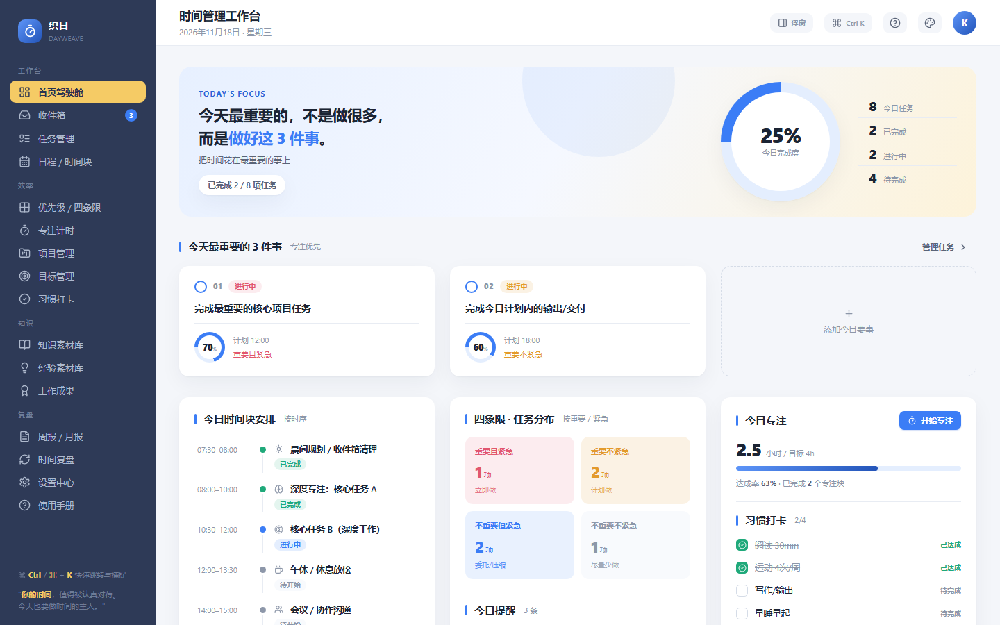
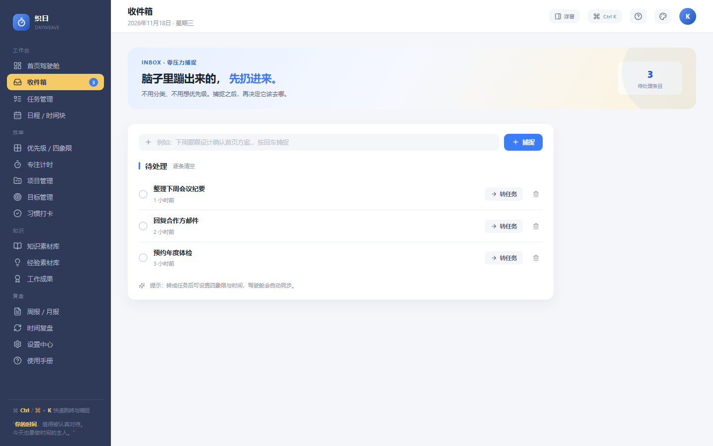
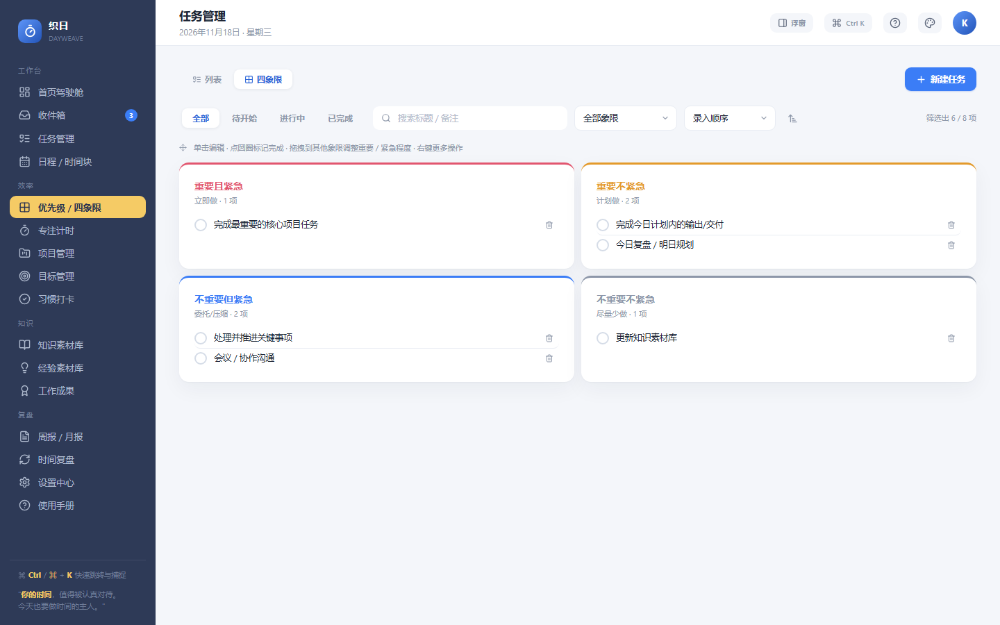
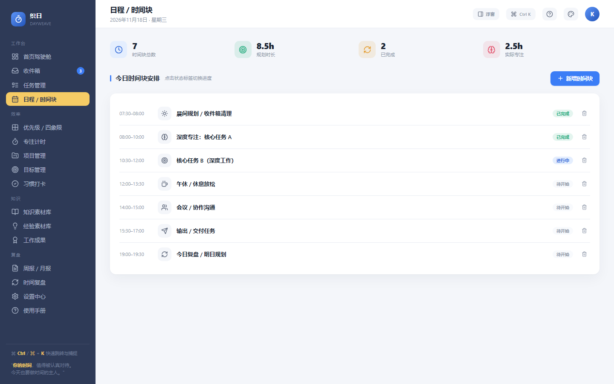
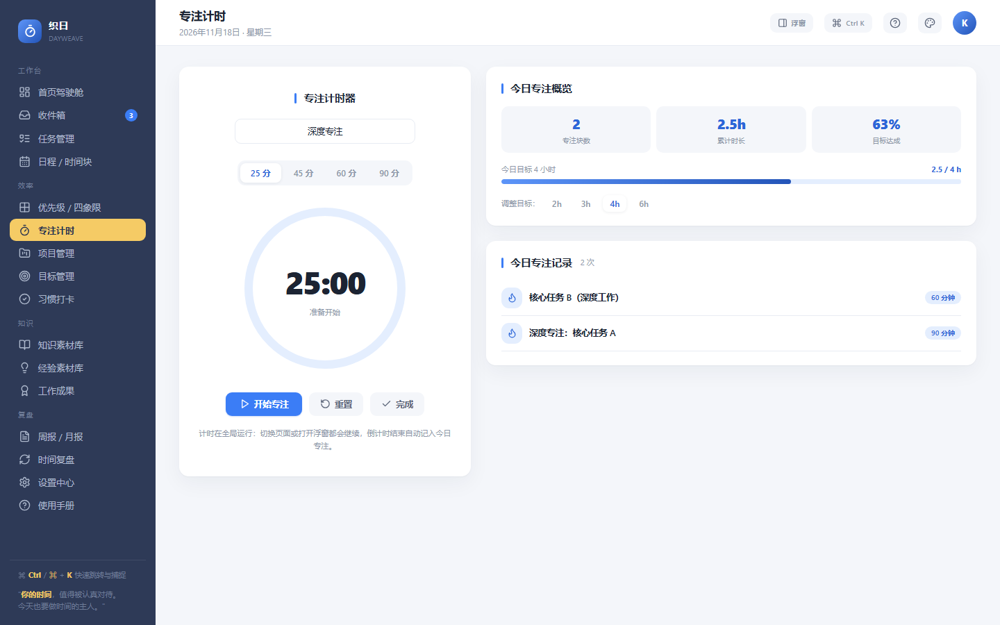
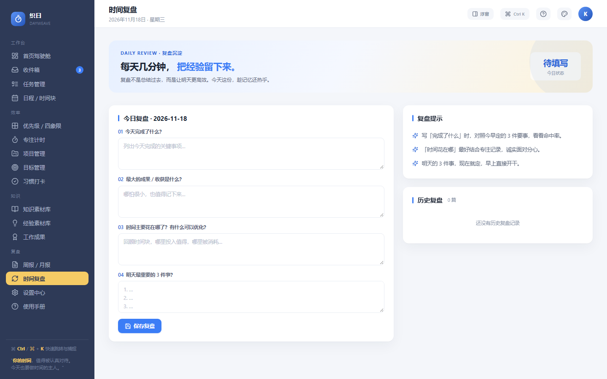

# 织日 DayWeave

**把时间和念头，织成每一天。**

一款本地优先的时间管理桌面应用：用时间块安排工作与生活，让突然冒出的想法随时有处安放。基于 **Tauri v2 + React 18 + Vite 6 + UnoCSS** 构建，数据全部保存在本地，无需注册登录，完全离线运行。

## 为什么叫「织日」

时间块是经线，突发的念头是纬线——一天的日子，是织出来的。我们相信好的时间管理不是把日程塞满，而是：

- **合理安排时间** — 时间块 + 四象限，五分钟想清楚今天要做什么
- **平衡工作与生活** — 工作任务和生活安排放在一起规划，日子不只是 KPI
- **接住每个念头** — 灵感、待办、突然想起的事，先扔进收件箱，回头再整理

## ✨ 功能特性

- **收件箱速记** — 任何突然的想法一秒记下，之后拖进时间块或转成任务
- **四象限任务管理** — 按重要/紧急矩阵组织任务，聚焦真正重要的事
- **时间块规划** — 以时间块安排一天，工作与生活事务统一编排，计时到点自动结算
- **专注计时** — 番茄钟式专注计时，支持独立浮窗（置顶、无边框、贴边收起）
- **复盘统计** — 回顾每日/每周时间花费，工作与生活的占比一目了然
- **目标 / 项目 / 习惯** — 目标拆解到项目与习惯打卡
- **素材收集** — 灵感与素材的快速收藏
- **导入导出** — 数据一键备份与迁移（`dayweave-backup-*.json`）
- **5 套主题** — 运行时切换配色，浮窗与手册共用同一套主题变量
- **命令面板** — `Ctrl/Cmd + K` 快速跳转 16 个功能入口
- **跨窗口同步** — 主窗口与浮窗通过 BroadcastChannel 实时同步

## 📸 截图

> 以下截图为首次启动自带的内置演示数据，存放在 `docs/`。

### 首页驾驶舱 · 五分钟想清楚今天要做什么

金句 + 今日完成度大环；下面依次是今天最重要的 3 件事、今日时间块安排、四象限分布，以及专注与习惯打卡进度。



### 收件箱 · 四象限

<table>
<tr>
<td width="50%" valign="top"><b>收件箱 · 零压力捕捉</b><br />脑子里蹦出来的，先扔进来，之后再决定去哪</td>
<td width="50%" valign="top"><b>四象限 · 任务分布</b><br />按重要 / 紧急排布，聚焦真正重要的事</td>
</tr>
<tr>
<td valign="top"></td>
<td valign="top"></td>
</tr>
</table>

### 时间块 · 专注计时

<table>
<tr>
<td width="50%" valign="top"><b>日程 / 时间块</b><br />一块一块安排一天，计时到点自动结算</td>
<td width="50%" valign="top"><b>专注计时</b><br />番茄钟式计时，可开独立浮窗置顶、贴边收起</td>
</tr>
<tr>
<td valign="top"></td>
<td valign="top"></td>
</tr>
</table>

### 时间复盘 · 独立浮窗

<table>
<tr>
<td width="70%" valign="top"><b>时间复盘</b><br />每天几分钟，把经验留下来；右侧给出复盘提示与历史记录</td>
<td width="30%" valign="top"><b>浮窗卡片</b><br />计时与今日任务常驻桌面，与主窗口实时同步</td>
</tr>
<tr>
<td valign="top"></td>
<td valign="top"></td>
</tr>
</table>

## 🚀 快速开始

### 环境要求

- [Node.js](https://nodejs.org/) ≥ 20 与 [pnpm](https://pnpm.io/)
- [Rust](https://www.rust-lang.org/tools/install)（含 MSVC 工具链）
- Windows 10/11（当前仅配置了 Windows 打包目标）

### 开发运行

```bash
pnpm install
pnpm tauri:dev
```

### 构建安装包

```bash
pnpm tauri:build
# 产物: src-tauri/target/release/bundle/msi/DayWeave_*.msi
```

### 仅跑前端（浏览器模式）

```bash
pnpm dev          # http://localhost:1420
```

浏览器模式下浮窗为应用内浮层（`?mini=1` / `#mini` 可直接打开浮窗页）。

## 🧪 测试

```bash
pnpm test:e2e         # 完整套件，连续 2 轮
pnpm test:e2e:quick   # 快速 1 轮
node tests/e2e.cjs --only=浮窗 --rounds=1   # 只跑单个套件
```

E2E 基于本机 Chrome CDP 驱动，零依赖 Node 脚本，详见 [tests/README.md](tests/README.md)。

## 🏗️ 技术架构

| 层 | 技术 |
|---|---|
| 前端 | React 18 + Vite 6 + UnoCSS |
| 桌面壳 | Tauri v2（无自定义 Rust command） |
| 状态 | 单一 Context Store（`src/store.jsx`）+ localStorage 持久化 |
| 同步 | BroadcastChannel + storage 事件 |
| 测试 | 零依赖 CDP E2E（`tests/e2e.cjs`） |

- 无路由库：`App.jsx` 用 `NAV` 表 + 本地 state 管理 16 个入口
- 主题通过 CSS 变量运行时注入（`src/theme.js`），共 5 套
- 数据存储于 localStorage key `time-master-state-v1`（历史内部标识，保持不变以保证老用户数据兼容）

详细架构说明见 [CODEBUDDY.md](CODEBUDDY.md)。

## 📦 版本发布

版本号需同步更新以下 4 处：

1. `package.json`
2. `src-tauri/tauri.conf.json`
3. `src-tauri/Cargo.toml`
4. 内置手册 `src/help/guide.html`

## 📄 License

[MIT](LICENSE)
